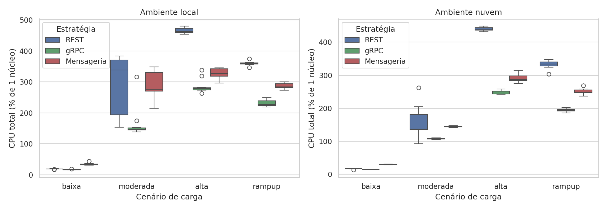
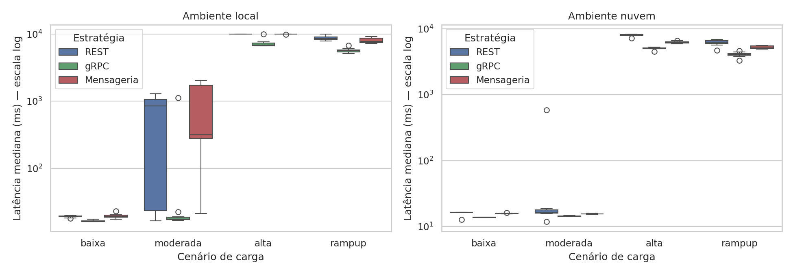
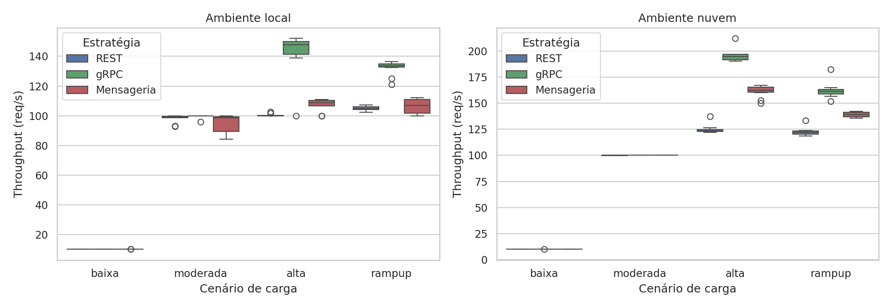

# Resultados dos experimentos

Gerado por `analysis/estatistica.py` a partir de 240 execuções. Amostras suspeitas excluídas (saltos de relógio): 2612.

## Métodos

- **Unidade de análise:** cada execução (repetição) de 60 s de medição, após 30 s de aquecimento,
  com ambiente recriado do zero. As métricas de cada execução vêm do k6 (lado do cliente);
  CPU e memória somam os contêineres da aplicação (serviços, bancos e broker) via `docker stats`.
- **Descritiva:** média, desvio padrão, mediana, coeficiente de variação (CV) e intervalo de
  confiança de 95% da média (t de Student).
- **Entre estratégias:** Kruskal-Wallis (3 grupos) seguido de Mann-Whitney bilateral par a par,
  com correção de Holm para comparações múltiplas. Testes não paramétricos porque, com ~10
  repetições por grupo, não se pode assumir normalidade, e métricas de latência costumam ser
  assimétricas.
- **Tamanho de efeito:** delta de Cliff (−1 a 1), com os limiares de Romano et al. (2006):
  < 0,147 desprezível, < 0,33 pequeno, < 0,474 médio, ≥ 0,474 grande. Complementa o p-valor,
  que sozinho não diz se a diferença é relevante.
- **Local × nuvem:** Mann-Whitney (diferença de posição) e Brown-Forsythe (diferença de
  variabilidade), além da comparação dos CVs.
- **Nível de significância:** α = 0,05.
- **Amostras suspeitas:** requisições com duração acima de 2× o timeout (impossíveis na prática,
  causadas por saltos de relógio do host) são excluídas das estatísticas de latência pelo k6 e
  contadas em `amostras_suspeitas`.

## Estatística descritiva

### Ambiente local

| Cenário | Estratégia | n | Latência média (ms) | Latência mediana (ms) | Latência p95 (ms) | Throughput (req/s) | Erro técnico (%) | CPU total (% de 1 núcleo) | Memória total (MB) |
|---|---|---|---|---|---|---|---|---|---|
| baixa | REST | 10 | 20,02 ± 1,05 | 19,15 ± 0,63 | 24,87 ± 3,02 | 10,01 ± 0,01 | 0,00 ± 0,00 | 18,9 ± 0,7 | 385,3 ± 2,1 |
| baixa | gRPC | 10 | 17,56 ± 1,51 | 16,45 ± 0,44 | 22,74 ± 3,88 | 10,01 ± 0,01 | 0,00 ± 0,00 | 16,5 ± 0,9 | 406,4 ± 4,9 |
| baixa | Mensageria | 10 | 21,84 ± 3,61 | 19,52 ± 1,48 | 32,97 ± 10,10 | 10,01 ± 0,01 | 0,00 ± 0,00 | 34,1 ± 4,2 | 533,8 ± 7,9 |
| moderada | REST | 10 | 740,51 ± 581,62 | 632,97 ± 544,03 | 1.525,82 ± 1.226,66 | 97,99 ± 2,69 | 0,03 ± 0,09 | 292,7 ± 95,1 | 466,2 ± 21,0 |
| moderada | gRPC | 10 | 157,11 ± 362,30 | 127,82 ± 346,77 | 390,30 ± 731,64 | 99,60 ± 1,32 | 0,00 ± 0,00 | 165,6 ± 53,9 | 448,7 ± 14,5 |
| moderada | Mensageria | 10 | 978,31 ± 811,30 | 868,04 ± 857,28 | 1.980,79 ± 1.157,35 | 94,73 ± 6,26 | 0,00 ± 0,00 | 289,0 ± 45,4 | 592,1 ± 13,1 |
| alta | REST | 10 | 10.342,27 ± 145,74 | 10.000,57 ± 0,02 | 11.444,21 ± 894,04 | 100,44 ± 0,91 | 98,61 ± 2,86 | 465,9 ± 9,1 | 545,3 ± 7,7 |
| alta | gRPC | 10 | 7.538,83 ± 1.212,09 | 7.231,19 ± 1.035,64 | 10.421,62 ± 1.202,14 | 142,22 ± 15,49 | 12,94 ± 30,73 | 286,0 ± 23,8 | 617,7 ± 11,6 |
| alta | Mensageria | 10 | 9.812,80 ± 662,95 | 9.976,78 ± 74,34 | 11.663,75 ± 923,93 | 107,27 ± 4,12 | 67,30 ± 19,91 | 327,3 ± 16,5 | 701,9 ± 16,0 |
| rampup | REST | 10 | 6.382,02 ± 172,21 | 8.714,41 ± 610,78 | 11.286,14 ± 908,08 | 104,95 ± 1,55 | 25,52 ± 14,05 | 360,1 ± 7,0 | 491,0 ± 11,9 |
| rampup | gRPC | 10 | 4.491,56 ± 297,51 | 5.688,67 ± 485,16 | 8.384,22 ± 918,62 | 132,05 ± 5,02 | 0,18 ± 0,21 | 231,1 ± 10,1 | 517,2 ± 9,1 |
| rampup | Mensageria | 10 | 6.473,58 ± 501,59 | 8.047,39 ± 759,34 | 11.069,95 ± 723,04 | 106,50 ± 4,88 | 13,33 ± 12,47 | 287,6 ± 8,7 | 642,3 ± 10,7 |

### Ambiente nuvem

| Cenário | Estratégia | n | Latência média (ms) | Latência mediana (ms) | Latência p95 (ms) | Throughput (req/s) | Erro técnico (%) | CPU total (% de 1 núcleo) | Memória total (MB) |
|---|---|---|---|---|---|---|---|---|---|
| baixa | REST | 10 | 16,32 ± 1,08 | 16,04 ± 1,14 | 17,93 ± 0,80 | 10,01 ± 0,01 | 0,00 ± 0,00 | 16,4 ± 1,2 | 353,1 ± 1,0 |
| baixa | gRPC | 10 | 13,93 ± 0,08 | 13,82 ± 0,09 | 15,21 ± 0,11 | 10,02 ± 0,01 | 0,00 ± 0,00 | 14,1 ± 0,1 | 371,9 ± 0,7 |
| baixa | Mensageria | 10 | 16,51 ± 0,58 | 15,77 ± 0,21 | 21,90 ± 4,49 | 10,01 ± 0,01 | 0,00 ± 0,00 | 29,8 ± 0,9 | 499,5 ± 1,7 |
| moderada | REST | 10 | 134,51 ± 207,60 | 72,78 ± 178,94 | 328,03 ± 499,11 | 99,90 ± 0,18 | 0,01 ± 0,01 | 156,4 ± 49,3 | 413,2 ± 11,9 |
| moderada | gRPC | 10 | 14,52 ± 0,18 | 14,45 ± 0,13 | 16,15 ± 0,18 | 100,02 ± 0,00 | 0,00 ± 0,00 | 107,5 ± 1,6 | 410,9 ± 1,8 |
| moderada | Mensageria | 10 | 17,94 ± 0,61 | 15,56 ± 0,17 | 35,70 ± 2,73 | 100,01 ± 0,01 | 0,00 ± 0,00 | 144,3 ± 1,8 | 541,8 ± 0,9 |
| alta | REST | 10 | 8.326,08 ± 306,16 | 8.062,53 ± 311,69 | 10.000,61 ± 0,19 | 124,90 ± 4,55 | 16,91 ± 4,49 | 439,9 ± 5,3 | 520,1 ± 4,0 |
| alta | gRPC | 10 | 5.141,90 ± 177,05 | 5.039,83 ± 205,22 | 6.851,01 ± 190,31 | 195,50 ± 6,42 | 0,02 ± 0,04 | 247,7 ± 5,9 | 574,7 ± 5,0 |
| alta | Mensageria | 10 | 6.325,00 ± 234,96 | 6.223,43 ± 242,45 | 8.202,85 ± 605,57 | 161,16 ± 5,63 | 0,31 ± 0,33 | 291,3 ± 12,5 | 655,3 ± 9,6 |
| rampup | REST | 10 | 4.938,76 ± 269,34 | 6.180,53 ± 651,48 | 8.582,79 ± 337,62 | 122,64 ± 4,11 | 0,90 ± 0,54 | 332,5 ± 13,0 | 456,6 ± 3,7 |
| rampup | gRPC | 10 | 3.115,91 ± 230,80 | 4.063,83 ± 359,79 | 5.417,15 ± 357,41 | 162,33 ± 7,99 | 0,00 ± 0,00 | 193,4 ± 4,8 | 468,4 ± 2,7 |
| rampup | Mensageria | 10 | 4.184,81 ± 123,56 | 5.248,32 ± 235,11 | 6.916,18 ± 156,63 | 138,89 ± 2,46 | 0,04 ± 0,05 | 250,3 ± 9,5 | 581,9 ± 3,2 |

Valores: média ± desvio padrão entre as repetições (cada repetição = uma execução de 60 s). Intervalos de confiança de 95% e coeficientes de variação estão em descritiva.csv.

## Comparação entre estratégias

### Ambiente local

| Cenário | Métrica | Kruskal-Wallis p | Par | Medianas | p (Holm) | δ de Cliff | Sig. |
|---|---|---|---|---|---|---|---|
| baixa | Latência média (ms) | < 0,001 | REST × gRPC | 19,90 × 16,77 | 0,012 | 0,74 (grande) | sim |
| baixa | Latência média (ms) | < 0,001 | REST × Mensageria | 19,90 × 20,71 | 0,241 | -0,32 (pequeno) | não |
| baixa | Latência média (ms) | < 0,001 | gRPC × Mensageria | 16,77 × 20,71 | 0,002 | -0,90 (grande) | sim |
| baixa | Latência mediana (ms) | < 0,001 | REST × gRPC | 19,38 × 16,34 | < 0,001 | 1,00 (grande) | sim |
| baixa | Latência mediana (ms) | < 0,001 | REST × Mensageria | 19,38 × 19,22 | 0,850 | -0,06 (desprezível) | não |
| baixa | Latência mediana (ms) | < 0,001 | gRPC × Mensageria | 16,34 × 19,22 | < 0,001 | -1,00 (grande) | sim |
| baixa | Latência p95 (ms) | 0,002 | REST × gRPC | 23,75 × 20,99 | 0,064 | 0,50 (grande) | não |
| baixa | Latência p95 (ms) | 0,002 | REST × Mensageria | 23,75 × 31,46 | 0,018 | -0,70 (grande) | sim |
| baixa | Latência p95 (ms) | 0,002 | gRPC × Mensageria | 20,99 × 31,46 | 0,008 | -0,80 (grande) | sim |
| baixa | Throughput (req/s) | 0,379 | REST × gRPC | 10,01 × 10,02 | 0,732 | -0,10 (desprezível) | não |
| baixa | Throughput (req/s) | 0,379 | REST × Mensageria | 10,01 × 10,02 | 0,555 | -0,30 (pequeno) | não |
| baixa | Throughput (req/s) | 0,379 | gRPC × Mensageria | 10,02 × 10,02 | 0,732 | -0,20 (pequeno) | não |
| baixa | Erro técnico (%) | — | REST × gRPC | 0,00 × 0,00 | 1,000 | 0,00 (desprezível) | não |
| baixa | Erro técnico (%) | — | REST × Mensageria | 0,00 × 0,00 | 1,000 | 0,00 (desprezível) | não |
| baixa | Erro técnico (%) | — | gRPC × Mensageria | 0,00 × 0,00 | 1,000 | 0,00 (desprezível) | não |
| baixa | CPU total (% de 1 núcleo) | < 0,001 | REST × gRPC | 19,2 × 16,1 | < 0,001 | 0,96 (grande) | sim |
| baixa | CPU total (% de 1 núcleo) | < 0,001 | REST × Mensageria | 19,2 × 34,1 | < 0,001 | -1,00 (grande) | sim |
| baixa | CPU total (% de 1 núcleo) | < 0,001 | gRPC × Mensageria | 16,1 × 34,1 | < 0,001 | -1,00 (grande) | sim |
| baixa | Memória total (MB) | < 0,001 | REST × gRPC | 385,0 × 405,1 | < 0,001 | -1,00 (grande) | sim |
| baixa | Memória total (MB) | < 0,001 | REST × Mensageria | 385,0 × 531,6 | < 0,001 | -1,00 (grande) | sim |
| baixa | Memória total (MB) | < 0,001 | gRPC × Mensageria | 405,1 × 531,6 | < 0,001 | -1,00 (grande) | sim |
| moderada | Latência média (ms) | 0,009 | REST × gRPC | 879,81 × 30,98 | 0,178 | 0,46 (médio) | não |
| moderada | Latência média (ms) | 0,009 | REST × Mensageria | 879,81 × 521,86 | 0,473 | -0,20 (pequeno) | não |
| moderada | Latência média (ms) | 0,009 | gRPC × Mensageria | 30,98 × 521,86 | 0,004 | -0,86 (grande) | sim |
| moderada | Latência mediana (ms) | 0,004 | REST × gRPC | 854,41 × 17,42 | 0,051 | 0,60 (grande) | não |
| moderada | Latência mediana (ms) | 0,004 | REST × Mensageria | 854,41 × 316,88 | 0,385 | -0,24 (pequeno) | não |
| moderada | Latência mediana (ms) | 0,004 | gRPC × Mensageria | 17,42 × 316,88 | 0,004 | -0,86 (grande) | sim |
| moderada | Latência p95 (ms) | 0,011 | REST × gRPC | 1.630,96 × 47,34 | 0,178 | 0,46 (médio) | não |
| moderada | Latência p95 (ms) | 0,011 | REST × Mensageria | 1.630,96 × 1.608,40 | 0,734 | -0,10 (desprezível) | não |
| moderada | Latência p95 (ms) | 0,011 | gRPC × Mensageria | 47,34 × 1.608,40 | 0,004 | -0,86 (grande) | sim |
| moderada | Throughput (req/s) | 0,003 | REST × gRPC | 98,82 × 100,02 | 0,038 | -0,60 (grande) | sim |
| moderada | Throughput (req/s) | 0,003 | REST × Mensageria | 98,82 × 98,74 | 0,405 | 0,23 (pequeno) | não |
| moderada | Throughput (req/s) | 0,003 | gRPC × Mensageria | 100,02 × 98,74 | 0,003 | 0,86 (grande) | sim |
| moderada | Erro técnico (%) | 0,040 | REST × gRPC | 0,00 × 0,00 | 0,234 | 0,30 (pequeno) | não |
| moderada | Erro técnico (%) | 0,040 | REST × Mensageria | 0,00 × 0,00 | 0,234 | 0,30 (pequeno) | não |
| moderada | Erro técnico (%) | 0,040 | gRPC × Mensageria | 0,00 × 0,00 | 1,000 | 0,00 (desprezível) | não |
| moderada | CPU total (% de 1 núcleo) | < 0,001 | REST × gRPC | 339,0 × 146,2 | 0,003 | 0,86 (grande) | sim |
| moderada | CPU total (% de 1 núcleo) | < 0,001 | REST × Mensageria | 339,0 × 275,9 | 0,571 | 0,16 (pequeno) | não |
| moderada | CPU total (% de 1 núcleo) | < 0,001 | gRPC × Mensageria | 146,2 × 275,9 | 0,003 | -0,88 (grande) | sim |
| moderada | Memória total (MB) | < 0,001 | REST × gRPC | 476,6 × 444,0 | 0,307 | 0,28 (pequeno) | não |
| moderada | Memória total (MB) | < 0,001 | REST × Mensageria | 476,6 × 584,4 | < 0,001 | -1,00 (grande) | sim |
| moderada | Memória total (MB) | < 0,001 | gRPC × Mensageria | 444,0 × 584,4 | < 0,001 | -1,00 (grande) | sim |
| alta | Latência média (ms) | < 0,001 | REST × gRPC | 10.287,91 × 7.236,83 | 0,008 | 0,80 (grande) | sim |
| alta | Latência média (ms) | < 0,001 | REST × Mensageria | 10.287,91 × 9.917,22 | 0,021 | 0,62 (grande) | sim |
| alta | Latência média (ms) | < 0,001 | gRPC × Mensageria | 7.236,83 × 9.917,22 | 0,008 | -0,80 (grande) | sim |
| alta | Latência mediana (ms) | < 0,001 | REST × gRPC | 10.000,57 × 6.819,45 | < 0,001 | 0,96 (grande) | sim |
| alta | Latência mediana (ms) | < 0,001 | REST × Mensageria | 10.000,57 × 10.000,24 | 0,003 | 0,84 (grande) | sim |
| alta | Latência mediana (ms) | < 0,001 | gRPC × Mensageria | 6.819,45 × 10.000,24 | 0,003 | -0,83 (grande) | sim |
| alta | Latência p95 (ms) | 0,005 | REST × gRPC | 11.016,00 × 10.001,01 | 0,028 | 0,66 (grande) | sim |
| alta | Latência p95 (ms) | 0,005 | REST × Mensageria | 11.016,00 × 11.117,16 | 0,273 | -0,30 (pequeno) | não |
| alta | Latência p95 (ms) | 0,005 | gRPC × Mensageria | 10.001,01 × 11.117,16 | 0,014 | -0,76 (grande) | sim |
| alta | Throughput (req/s) | < 0,001 | REST × gRPC | 100,02 × 147,72 | 0,002 | -0,90 (grande) | sim |
| alta | Throughput (req/s) | < 0,001 | REST × Mensageria | 100,02 × 108,68 | 0,010 | -0,68 (grande) | sim |
| alta | Throughput (req/s) | < 0,001 | gRPC × Mensageria | 147,72 × 108,68 | 0,003 | 0,84 (grande) | sim |
| alta | Erro técnico (%) | < 0,001 | REST × gRPC | 99,96 × 3,02 | 0,003 | 0,89 (grande) | sim |
| alta | Erro técnico (%) | < 0,001 | REST × Mensageria | 99,96 × 64,97 | 0,010 | 0,68 (grande) | sim |
| alta | Erro técnico (%) | < 0,001 | gRPC × Mensageria | 3,02 × 64,97 | 0,003 | -0,84 (grande) | sim |
| alta | CPU total (% de 1 núcleo) | < 0,001 | REST × gRPC | 462,8 × 278,0 | < 0,001 | 1,00 (grande) | sim |
| alta | CPU total (% de 1 núcleo) | < 0,001 | REST × Mensageria | 462,8 × 327,7 | < 0,001 | 1,00 (grande) | sim |
| alta | CPU total (% de 1 núcleo) | < 0,001 | gRPC × Mensageria | 278,0 × 327,7 | 0,002 | -0,82 (grande) | sim |
| alta | Memória total (MB) | < 0,001 | REST × gRPC | 543,8 × 616,6 | < 0,001 | -1,00 (grande) | sim |
| alta | Memória total (MB) | < 0,001 | REST × Mensageria | 543,8 × 697,9 | < 0,001 | -1,00 (grande) | sim |
| alta | Memória total (MB) | < 0,001 | gRPC × Mensageria | 616,6 × 697,9 | < 0,001 | -1,00 (grande) | sim |
| rampup | Latência média (ms) | < 0,001 | REST × gRPC | 6.385,53 × 4.461,01 | < 0,001 | 1,00 (grande) | sim |
| rampup | Latência média (ms) | < 0,001 | REST × Mensageria | 6.385,53 × 6.273,37 | 0,791 | 0,08 (desprezível) | não |
| rampup | Latência média (ms) | < 0,001 | gRPC × Mensageria | 4.461,01 × 6.273,37 | < 0,001 | -1,00 (grande) | sim |
| rampup | Latência mediana (ms) | < 0,001 | REST × gRPC | 8.595,60 × 5.639,83 | < 0,001 | 1,00 (grande) | sim |
| rampup | Latência mediana (ms) | < 0,001 | REST × Mensageria | 8.595,60 × 7.769,13 | 0,064 | 0,50 (grande) | não |
| rampup | Latência mediana (ms) | < 0,001 | gRPC × Mensageria | 5.639,83 × 7.769,13 | < 0,001 | -1,00 (grande) | sim |
| rampup | Latência p95 (ms) | < 0,001 | REST × gRPC | 10.902,80 × 8.095,49 | < 0,001 | 1,00 (grande) | sim |
| rampup | Latência p95 (ms) | < 0,001 | REST × Mensageria | 10.902,80 × 10.889,16 | 0,791 | 0,08 (desprezível) | não |
| rampup | Latência p95 (ms) | < 0,001 | gRPC × Mensageria | 8.095,49 × 10.889,16 | < 0,001 | -1,00 (grande) | sim |
| rampup | Throughput (req/s) | < 0,001 | REST × gRPC | 104,88 × 133,56 | < 0,001 | -1,00 (grande) | sim |
| rampup | Throughput (req/s) | < 0,001 | REST × Mensageria | 104,88 × 107,01 | 0,385 | -0,24 (pequeno) | não |
| rampup | Throughput (req/s) | < 0,001 | gRPC × Mensageria | 133,56 × 107,01 | < 0,001 | 1,00 (grande) | sim |
| rampup | Erro técnico (%) | < 0,001 | REST × gRPC | 20,64 × 0,08 | < 0,001 | 1,00 (grande) | sim |
| rampup | Erro técnico (%) | < 0,001 | REST × Mensageria | 20,64 × 8,43 | 0,038 | 0,56 (grande) | sim |
| rampup | Erro técnico (%) | < 0,001 | gRPC × Mensageria | 0,08 × 8,43 | < 0,001 | -1,00 (grande) | sim |
| rampup | CPU total (% de 1 núcleo) | < 0,001 | REST × gRPC | 359,8 × 226,7 | < 0,001 | 1,00 (grande) | sim |
| rampup | CPU total (% de 1 núcleo) | < 0,001 | REST × Mensageria | 359,8 × 286,2 | < 0,001 | 1,00 (grande) | sim |
| rampup | CPU total (% de 1 núcleo) | < 0,001 | gRPC × Mensageria | 226,7 × 286,2 | < 0,001 | -1,00 (grande) | sim |
| rampup | Memória total (MB) | < 0,001 | REST × gRPC | 489,2 × 513,4 | 0,002 | -0,84 (grande) | sim |
| rampup | Memória total (MB) | < 0,001 | REST × Mensageria | 489,2 × 642,7 | < 0,001 | -1,00 (grande) | sim |
| rampup | Memória total (MB) | < 0,001 | gRPC × Mensageria | 513,4 × 642,7 | < 0,001 | -1,00 (grande) | sim |

### Ambiente nuvem

| Cenário | Métrica | Kruskal-Wallis p | Par | Medianas | p (Holm) | δ de Cliff | Sig. |
|---|---|---|---|---|---|---|---|
| baixa | Latência média (ms) | < 0,001 | REST × gRPC | 16,65 × 13,95 | 0,006 | 0,80 (grande) | sim |
| baixa | Latência média (ms) | < 0,001 | REST × Mensageria | 16,65 × 16,51 | 0,520 | 0,18 (pequeno) | não |
| baixa | Latência média (ms) | < 0,001 | gRPC × Mensageria | 13,95 × 16,51 | < 0,001 | -1,00 (grande) | sim |
| baixa | Latência mediana (ms) | < 0,001 | REST × gRPC | 16,39 × 13,82 | 0,006 | 0,80 (grande) | sim |
| baixa | Latência mediana (ms) | < 0,001 | REST × Mensageria | 16,39 × 15,73 | 0,006 | 0,80 (grande) | sim |
| baixa | Latência mediana (ms) | < 0,001 | gRPC × Mensageria | 13,82 × 15,73 | < 0,001 | -1,00 (grande) | sim |
| baixa | Latência p95 (ms) | < 0,001 | REST × gRPC | 18,20 × 15,20 | < 0,001 | 1,00 (grande) | sim |
| baixa | Latência p95 (ms) | < 0,001 | REST × Mensageria | 18,20 × 20,56 | 0,140 | -0,40 (médio) | não |
| baixa | Latência p95 (ms) | < 0,001 | gRPC × Mensageria | 15,20 × 20,56 | < 0,001 | -1,00 (grande) | sim |
| baixa | Throughput (req/s) | 0,060 | REST × gRPC | 10,00 × 10,02 | 0,075 | -0,50 (grande) | não |
| baixa | Throughput (req/s) | 0,060 | REST × Mensageria | 10,00 × 10,01 | 0,693 | -0,10 (desprezível) | não |
| baixa | Throughput (req/s) | 0,060 | gRPC × Mensageria | 10,02 × 10,01 | 0,127 | 0,40 (médio) | não |
| baixa | Erro técnico (%) | — | REST × gRPC | 0,00 × 0,00 | 1,000 | 0,00 (desprezível) | não |
| baixa | Erro técnico (%) | — | REST × Mensageria | 0,00 × 0,00 | 1,000 | 0,00 (desprezível) | não |
| baixa | Erro técnico (%) | — | gRPC × Mensageria | 0,00 × 0,00 | 1,000 | 0,00 (desprezível) | não |
| baixa | CPU total (% de 1 núcleo) | < 0,001 | REST × gRPC | 16,7 × 14,1 | 0,003 | 0,80 (grande) | sim |
| baixa | CPU total (% de 1 núcleo) | < 0,001 | REST × Mensageria | 16,7 × 29,8 | < 0,001 | -1,00 (grande) | sim |
| baixa | CPU total (% de 1 núcleo) | < 0,001 | gRPC × Mensageria | 14,1 × 29,8 | < 0,001 | -1,00 (grande) | sim |
| baixa | Memória total (MB) | < 0,001 | REST × gRPC | 353,6 × 372,3 | < 0,001 | -1,00 (grande) | sim |
| baixa | Memória total (MB) | < 0,001 | REST × Mensageria | 353,6 × 499,2 | < 0,001 | -1,00 (grande) | sim |
| baixa | Memória total (MB) | < 0,001 | gRPC × Mensageria | 372,3 × 499,2 | < 0,001 | -1,00 (grande) | sim |
| moderada | Latência média (ms) | < 0,001 | REST × gRPC | 16,75 × 14,53 | 0,006 | 0,80 (grande) | sim |
| moderada | Latência média (ms) | < 0,001 | REST × Mensageria | 16,75 × 17,86 | 0,427 | -0,22 (pequeno) | não |
| moderada | Latência média (ms) | < 0,001 | gRPC × Mensageria | 14,53 × 17,86 | < 0,001 | -1,00 (grande) | sim |
| moderada | Latência mediana (ms) | < 0,001 | REST × gRPC | 16,30 × 14,49 | 0,006 | 0,80 (grande) | sim |
| moderada | Latência mediana (ms) | < 0,001 | REST × Mensageria | 16,30 × 15,52 | 0,006 | 0,78 (grande) | sim |
| moderada | Latência mediana (ms) | < 0,001 | gRPC × Mensageria | 14,49 × 15,52 | < 0,001 | -1,00 (grande) | sim |
| moderada | Latência p95 (ms) | < 0,001 | REST × gRPC | 19,16 × 16,18 | 0,006 | 0,80 (grande) | sim |
| moderada | Latência p95 (ms) | < 0,001 | REST × Mensageria | 19,16 × 35,56 | 0,140 | -0,40 (médio) | não |
| moderada | Latência p95 (ms) | < 0,001 | gRPC × Mensageria | 16,18 × 35,56 | < 0,001 | -1,00 (grande) | sim |
| moderada | Throughput (req/s) | 0,018 | REST × gRPC | 100,01 × 100,02 | 0,030 | -0,50 (grande) | sim |
| moderada | Throughput (req/s) | 0,018 | REST × Mensageria | 100,01 × 100,00 | 0,774 | -0,08 (desprezível) | não |
| moderada | Throughput (req/s) | 0,018 | gRPC × Mensageria | 100,02 × 100,00 | 0,015 | 0,60 (grande) | sim |
| moderada | Erro técnico (%) | 0,126 | REST × gRPC | 0,00 × 0,00 | 0,504 | 0,20 (pequeno) | não |
| moderada | Erro técnico (%) | 0,126 | REST × Mensageria | 0,00 × 0,00 | 0,504 | 0,20 (pequeno) | não |
| moderada | Erro técnico (%) | 0,126 | gRPC × Mensageria | 0,00 × 0,00 | 1,000 | 0,00 (desprezível) | não |
| moderada | CPU total (% de 1 núcleo) | < 0,001 | REST × gRPC | 136,3 × 107,9 | 0,006 | 0,80 (grande) | sim |
| moderada | CPU total (% de 1 núcleo) | < 0,001 | REST × Mensageria | 136,3 × 144,1 | 0,140 | -0,40 (médio) | não |
| moderada | CPU total (% de 1 núcleo) | < 0,001 | gRPC × Mensageria | 107,9 × 144,1 | < 0,001 | -1,00 (grande) | sim |
| moderada | Memória total (MB) | < 0,001 | REST × gRPC | 408,9 × 411,1 | 0,473 | -0,20 (pequeno) | não |
| moderada | Memória total (MB) | < 0,001 | REST × Mensageria | 408,9 × 541,8 | < 0,001 | -1,00 (grande) | sim |
| moderada | Memória total (MB) | < 0,001 | gRPC × Mensageria | 411,1 × 541,8 | < 0,001 | -1,00 (grande) | sim |
| alta | Latência média (ms) | < 0,001 | REST × gRPC | 8.401,96 × 5.165,17 | < 0,001 | 1,00 (grande) | sim |
| alta | Latência média (ms) | < 0,001 | REST × Mensageria | 8.401,96 × 6.247,61 | < 0,001 | 1,00 (grande) | sim |
| alta | Latência média (ms) | < 0,001 | gRPC × Mensageria | 5.165,17 × 6.247,61 | < 0,001 | -1,00 (grande) | sim |
| alta | Latência mediana (ms) | < 0,001 | REST × gRPC | 8.168,91 × 5.087,53 | < 0,001 | 1,00 (grande) | sim |
| alta | Latência mediana (ms) | < 0,001 | REST × Mensageria | 8.168,91 × 6.178,72 | < 0,001 | 1,00 (grande) | sim |
| alta | Latência mediana (ms) | < 0,001 | gRPC × Mensageria | 5.087,53 × 6.178,72 | < 0,001 | -1,00 (grande) | sim |
| alta | Latência p95 (ms) | < 0,001 | REST × gRPC | 10.000,66 × 6.834,23 | < 0,001 | 1,00 (grande) | sim |
| alta | Latência p95 (ms) | < 0,001 | REST × Mensageria | 10.000,66 × 8.042,69 | < 0,001 | 1,00 (grande) | sim |
| alta | Latência p95 (ms) | < 0,001 | gRPC × Mensageria | 6.834,23 × 8.042,69 | < 0,001 | -1,00 (grande) | sim |
| alta | Throughput (req/s) | < 0,001 | REST × gRPC | 123,28 × 194,38 | < 0,001 | -1,00 (grande) | sim |
| alta | Throughput (req/s) | < 0,001 | REST × Mensageria | 123,28 × 162,03 | < 0,001 | -1,00 (grande) | sim |
| alta | Throughput (req/s) | < 0,001 | gRPC × Mensageria | 194,38 × 162,03 | < 0,001 | 1,00 (grande) | sim |
| alta | Erro técnico (%) | < 0,001 | REST × gRPC | 17,85 × 0,00 | < 0,001 | 1,00 (grande) | sim |
| alta | Erro técnico (%) | < 0,001 | REST × Mensageria | 17,85 × 0,23 | < 0,001 | 1,00 (grande) | sim |
| alta | Erro técnico (%) | < 0,001 | gRPC × Mensageria | 0,00 × 0,23 | < 0,001 | -0,88 (grande) | sim |
| alta | CPU total (% de 1 núcleo) | < 0,001 | REST × gRPC | 439,3 × 245,9 | < 0,001 | 1,00 (grande) | sim |
| alta | CPU total (% de 1 núcleo) | < 0,001 | REST × Mensageria | 439,3 × 286,5 | < 0,001 | 1,00 (grande) | sim |
| alta | CPU total (% de 1 núcleo) | < 0,001 | gRPC × Mensageria | 245,9 × 286,5 | < 0,001 | -1,00 (grande) | sim |
| alta | Memória total (MB) | < 0,001 | REST × gRPC | 520,1 × 574,2 | < 0,001 | -1,00 (grande) | sim |
| alta | Memória total (MB) | < 0,001 | REST × Mensageria | 520,1 × 659,3 | < 0,001 | -1,00 (grande) | sim |
| alta | Memória total (MB) | < 0,001 | gRPC × Mensageria | 574,2 × 659,3 | < 0,001 | -1,00 (grande) | sim |
| rampup | Latência média (ms) | < 0,001 | REST × gRPC | 4.995,74 × 3.147,33 | < 0,001 | 1,00 (grande) | sim |
| rampup | Latência média (ms) | < 0,001 | REST × Mensageria | 4.995,74 × 4.191,36 | < 0,001 | 0,92 (grande) | sim |
| rampup | Latência média (ms) | < 0,001 | gRPC × Mensageria | 3.147,33 × 4.191,36 | < 0,001 | -1,00 (grande) | sim |
| rampup | Latência mediana (ms) | < 0,001 | REST × gRPC | 6.258,82 × 4.102,50 | < 0,001 | 1,00 (grande) | sim |
| rampup | Latência mediana (ms) | < 0,001 | REST × Mensageria | 6.258,82 × 5.253,92 | 0,003 | 0,80 (grande) | sim |
| rampup | Latência mediana (ms) | < 0,001 | gRPC × Mensageria | 4.102,50 × 5.253,92 | < 0,001 | -1,00 (grande) | sim |
| rampup | Latência p95 (ms) | < 0,001 | REST × gRPC | 8.712,74 × 5.514,57 | < 0,001 | 1,00 (grande) | sim |
| rampup | Latência p95 (ms) | < 0,001 | REST × Mensageria | 8.712,74 × 6.910,59 | < 0,001 | 1,00 (grande) | sim |
| rampup | Latência p95 (ms) | < 0,001 | gRPC × Mensageria | 5.514,57 × 6.910,59 | < 0,001 | -1,00 (grande) | sim |
| rampup | Throughput (req/s) | < 0,001 | REST × gRPC | 121,92 × 161,57 | < 0,001 | -1,00 (grande) | sim |
| rampup | Throughput (req/s) | < 0,001 | REST × Mensageria | 121,92 × 139,01 | < 0,001 | -1,00 (grande) | sim |
| rampup | Throughput (req/s) | < 0,001 | gRPC × Mensageria | 161,57 × 139,01 | < 0,001 | 1,00 (grande) | sim |
| rampup | Erro técnico (%) | < 0,001 | REST × gRPC | 0,98 × 0,00 | < 0,001 | 0,90 (grande) | sim |
| rampup | Erro técnico (%) | < 0,001 | REST × Mensageria | 0,98 × 0,03 | 0,004 | 0,83 (grande) | sim |
| rampup | Erro técnico (%) | < 0,001 | gRPC × Mensageria | 0,00 × 0,03 | 0,004 | -0,70 (grande) | sim |
| rampup | CPU total (% de 1 núcleo) | < 0,001 | REST × gRPC | 333,3 × 192,7 | < 0,001 | 1,00 (grande) | sim |
| rampup | CPU total (% de 1 núcleo) | < 0,001 | REST × Mensageria | 333,3 × 249,1 | < 0,001 | 1,00 (grande) | sim |
| rampup | CPU total (% de 1 núcleo) | < 0,001 | gRPC × Mensageria | 192,7 × 249,1 | < 0,001 | -1,00 (grande) | sim |
| rampup | Memória total (MB) | < 0,001 | REST × gRPC | 457,7 × 468,3 | < 0,001 | -1,00 (grande) | sim |
| rampup | Memória total (MB) | < 0,001 | REST × Mensageria | 457,7 × 581,8 | < 0,001 | -1,00 (grande) | sim |
| rampup | Memória total (MB) | < 0,001 | gRPC × Mensageria | 468,3 × 581,8 | < 0,001 | -1,00 (grande) | sim |

δ de Cliff > 0: a primeira estratégia do par tem valores maiores. Significativo: p ajustado por Holm < 0,05.

## Comparação entre ambientes (local × nuvem)

| Cenário | Estratégia | Métrica | Mediana local × nuvem | p (posição) | δ nuvem vs local | CV local × nuvem (%) | p (variância) |
|---|---|---|---|---|---|---|---|
| baixa | REST | Latência média (ms) | 19,90 × 16,65 | < 0,001 | -1,00 (grande) | 5,2 × 6,6 | 0,384 |
| baixa | REST | Latência mediana (ms) | 19,38 × 16,39 | < 0,001 | -1,00 (grande) | 3,3 × 7,1 | 0,911 |
| baixa | REST | Latência p95 (ms) | 23,75 × 18,20 | < 0,001 | -1,00 (grande) | 12,2 × 4,5 | 0,064 |
| baixa | REST | Throughput (req/s) | 10,01 × 10,00 | 0,693 | -0,10 (desprezível) | 0,1 × 0,1 | 0,548 |
| baixa | REST | Erro técnico (%) | 0,00 × 0,00 | 1,000 | 0,00 (desprezível) | — × — | — |
| baixa | REST | CPU total (% de 1 núcleo) | 19,2 × 16,7 | < 0,001 | -1,00 (grande) | 3,9 × 7,6 | 0,982 |
| baixa | REST | Memória total (MB) | 385,0 × 353,6 | < 0,001 | -1,00 (grande) | 0,5 × 0,3 | 0,243 |
| baixa | gRPC | Latência média (ms) | 16,77 × 13,95 | < 0,001 | -1,00 (grande) | 8,6 × 0,6 | 0,037 |
| baixa | gRPC | Latência mediana (ms) | 16,34 × 13,82 | < 0,001 | -1,00 (grande) | 2,7 × 0,6 | 0,022 |
| baixa | gRPC | Latência p95 (ms) | 20,99 × 15,20 | < 0,001 | -1,00 (grande) | 17,1 × 0,7 | 0,021 |
| baixa | gRPC | Throughput (req/s) | 10,02 × 10,02 | 0,144 | 0,30 (pequeno) | 0,1 × 0,1 | 0,135 |
| baixa | gRPC | Erro técnico (%) | 0,00 × 0,00 | 1,000 | 0,00 (desprezível) | — × — | — |
| baixa | gRPC | CPU total (% de 1 núcleo) | 16,1 × 14,1 | < 0,001 | -1,00 (grande) | 5,6 × 1,0 | 0,067 |
| baixa | gRPC | Memória total (MB) | 405,1 × 372,3 | < 0,001 | -1,00 (grande) | 1,2 × 0,2 | 0,016 |
| baixa | Mensageria | Latência média (ms) | 20,71 × 16,51 | < 0,001 | -1,00 (grande) | 16,5 × 3,5 | 0,116 |
| baixa | Mensageria | Latência mediana (ms) | 19,22 × 15,73 | < 0,001 | -1,00 (grande) | 7,6 × 1,3 | 0,031 |
| baixa | Mensageria | Latência p95 (ms) | 31,46 × 20,56 | 0,003 | -0,80 (grande) | 30,6 × 20,5 | 0,233 |
| baixa | Mensageria | Throughput (req/s) | 10,02 × 10,01 | 0,185 | -0,30 (pequeno) | 0,1 × 0,1 | 0,037 |
| baixa | Mensageria | Erro técnico (%) | 0,00 × 0,00 | 1,000 | 0,00 (desprezível) | — × — | — |
| baixa | Mensageria | CPU total (% de 1 núcleo) | 34,1 × 29,8 | 0,009 | -0,70 (grande) | 12,4 × 3,0 | 0,063 |
| baixa | Mensageria | Memória total (MB) | 531,6 × 499,2 | < 0,001 | -1,00 (grande) | 1,5 × 0,3 | 0,076 |
| moderada | REST | Latência média (ms) | 879,81 × 16,75 | 0,003 | -0,80 (grande) | 78,5 × 154,3 | 0,008 |
| moderada | REST | Latência mediana (ms) | 854,41 × 16,30 | 0,001 | -0,88 (grande) | 85,9 × 245,9 | 0,004 |
| moderada | REST | Latência p95 (ms) | 1.630,96 × 19,16 | 0,002 | -0,82 (grande) | 80,4 × 152,2 | 0,071 |
| moderada | REST | Throughput (req/s) | 98,82 × 100,01 | 0,018 | 0,62 (grande) | 2,7 × 0,2 | 0,062 |
| moderada | REST | Erro técnico (%) | 0,00 × 0,00 | 0,585 | -0,12 (desprezível) | 278,1 × 225,0 | 0,353 |
| moderada | REST | CPU total (% de 1 núcleo) | 339,0 × 136,3 | 0,003 | -0,80 (grande) | 32,5 × 31,5 | 0,098 |
| moderada | REST | Memória total (MB) | 476,6 × 408,9 | < 0,001 | -0,96 (grande) | 4,5 × 2,9 | 0,166 |
| moderada | gRPC | Latência média (ms) | 30,98 × 14,53 | < 0,001 | -1,00 (grande) | 230,6 × 1,2 | 0,250 |
| moderada | gRPC | Latência mediana (ms) | 17,42 × 14,49 | < 0,001 | -1,00 (grande) | 271,3 × 0,9 | 0,327 |
| moderada | gRPC | Latência p95 (ms) | 47,34 × 16,18 | < 0,001 | -1,00 (grande) | 187,5 × 1,1 | 0,133 |
| moderada | gRPC | Throughput (req/s) | 100,02 × 100,02 | 0,078 | 0,30 (pequeno) | 1,3 × 0,0 | 0,326 |
| moderada | gRPC | Erro técnico (%) | 0,00 × 0,00 | 1,000 | 0,00 (desprezível) | — × — | — |
| moderada | gRPC | CPU total (% de 1 núcleo) | 146,2 × 107,9 | < 0,001 | -1,00 (grande) | 32,6 × 1,5 | 0,213 |
| moderada | gRPC | Memória total (MB) | 444,0 × 411,1 | < 0,001 | -1,00 (grande) | 3,2 × 0,4 | 0,253 |
| moderada | Mensageria | Latência média (ms) | 521,86 × 17,86 | < 0,001 | -1,00 (grande) | 82,9 × 3,4 | 0,005 |
| moderada | Mensageria | Latência mediana (ms) | 316,88 × 15,52 | < 0,001 | -1,00 (grande) | 98,8 × 1,1 | 0,010 |
| moderada | Mensageria | Latência p95 (ms) | 1.608,40 × 35,56 | < 0,001 | -1,00 (grande) | 58,4 × 7,6 | < 0,001 |
| moderada | Mensageria | Throughput (req/s) | 98,74 × 100,00 | < 0,001 | 0,94 (grande) | 6,6 × 0,0 | 0,021 |
| moderada | Mensageria | Erro técnico (%) | 0,00 × 0,00 | 1,000 | 0,00 (desprezível) | — × — | — |
| moderada | Mensageria | CPU total (% de 1 núcleo) | 275,9 × 144,1 | < 0,001 | -1,00 (grande) | 15,7 × 1,2 | 0,002 |
| moderada | Mensageria | Memória total (MB) | 584,4 × 541,8 | < 0,001 | -1,00 (grande) | 2,2 × 0,2 | 0,016 |
| alta | REST | Latência média (ms) | 10.287,91 × 8.401,96 | < 0,001 | -1,00 (grande) | 1,4 × 3,7 | 0,625 |
| alta | REST | Latência mediana (ms) | 10.000,57 × 8.168,91 | < 0,001 | -1,00 (grande) | 0,0 × 3,9 | 0,056 |
| alta | REST | Latência p95 (ms) | 11.016,00 × 10.000,66 | < 0,001 | -1,00 (grande) | 7,8 × 0,0 | 0,017 |
| alta | REST | Throughput (req/s) | 100,02 × 123,28 | < 0,001 | 1,00 (grande) | 0,9 × 3,6 | 0,192 |
| alta | REST | Erro técnico (%) | 99,96 × 17,85 | < 0,001 | -1,00 (grande) | 2,9 × 26,6 | 0,314 |
| alta | REST | CPU total (% de 1 núcleo) | 462,8 × 439,3 | < 0,001 | -1,00 (grande) | 2,0 × 1,2 | 0,135 |
| alta | REST | Memória total (MB) | 543,8 × 520,1 | < 0,001 | -1,00 (grande) | 1,4 × 0,8 | 0,597 |
| alta | gRPC | Latência média (ms) | 7.236,83 × 5.165,17 | < 0,001 | -1,00 (grande) | 16,1 × 3,4 | 0,202 |
| alta | gRPC | Latência mediana (ms) | 6.819,45 × 5.087,53 | < 0,001 | -1,00 (grande) | 14,3 × 4,1 | 0,186 |
| alta | gRPC | Latência p95 (ms) | 10.001,01 × 6.834,23 | < 0,001 | -1,00 (grande) | 11,5 × 2,8 | 0,087 |
| alta | gRPC | Throughput (req/s) | 147,72 × 194,38 | < 0,001 | 1,00 (grande) | 10,9 × 3,3 | 0,438 |
| alta | gRPC | Erro técnico (%) | 3,02 × 0,00 | < 0,001 | -1,00 (grande) | 237,4 × 210,8 | 0,228 |
| alta | gRPC | CPU total (% de 1 núcleo) | 278,0 × 245,9 | < 0,001 | -1,00 (grande) | 8,3 × 2,4 | 0,171 |
| alta | gRPC | Memória total (MB) | 616,6 × 574,2 | < 0,001 | -1,00 (grande) | 1,9 × 0,9 | 0,091 |
| alta | Mensageria | Latência média (ms) | 9.917,22 × 6.247,61 | < 0,001 | -1,00 (grande) | 6,8 × 3,7 | 0,060 |
| alta | Mensageria | Latência mediana (ms) | 10.000,24 × 6.178,72 | < 0,001 | -1,00 (grande) | 0,7 × 3,9 | 0,013 |
| alta | Mensageria | Latência p95 (ms) | 11.117,16 × 8.042,69 | < 0,001 | -1,00 (grande) | 7,9 × 7,4 | 0,409 |
| alta | Mensageria | Throughput (req/s) | 108,68 × 162,03 | < 0,001 | 1,00 (grande) | 3,8 × 3,5 | 0,571 |
| alta | Mensageria | Erro técnico (%) | 64,97 × 0,23 | < 0,001 | -1,00 (grande) | 29,6 × 107,0 | 0,001 |
| alta | Mensageria | CPU total (% de 1 núcleo) | 327,7 × 286,5 | < 0,001 | -0,92 (grande) | 5,0 × 4,3 | 0,332 |
| alta | Mensageria | Memória total (MB) | 697,9 × 659,3 | < 0,001 | -1,00 (grande) | 2,3 × 1,5 | 0,582 |
| rampup | REST | Latência média (ms) | 6.385,53 × 4.995,74 | < 0,001 | -1,00 (grande) | 2,7 × 5,5 | 0,662 |
| rampup | REST | Latência mediana (ms) | 8.595,60 × 6.258,82 | < 0,001 | -1,00 (grande) | 7,0 × 10,5 | 0,881 |
| rampup | REST | Latência p95 (ms) | 10.902,80 × 8.712,74 | < 0,001 | -1,00 (grande) | 8,0 × 3,9 | 0,083 |
| rampup | REST | Throughput (req/s) | 104,88 × 121,92 | < 0,001 | 1,00 (grande) | 1,5 × 3,4 | 0,283 |
| rampup | REST | Erro técnico (%) | 20,64 × 0,98 | < 0,001 | -1,00 (grande) | 55,1 × 60,3 | 0,009 |
| rampup | REST | CPU total (% de 1 núcleo) | 359,8 × 333,3 | < 0,001 | -0,96 (grande) | 1,9 × 3,9 | 0,140 |
| rampup | REST | Memória total (MB) | 489,2 × 457,7 | < 0,001 | -1,00 (grande) | 2,4 × 0,8 | 0,105 |
| rampup | gRPC | Latência média (ms) | 4.461,01 × 3.147,33 | < 0,001 | -1,00 (grande) | 6,6 × 7,4 | 0,135 |
| rampup | gRPC | Latência mediana (ms) | 5.639,83 × 4.102,50 | < 0,001 | -1,00 (grande) | 8,5 × 8,9 | 0,436 |
| rampup | gRPC | Latência p95 (ms) | 8.095,49 × 5.514,57 | < 0,001 | -1,00 (grande) | 11,0 × 6,6 | 0,010 |
| rampup | gRPC | Throughput (req/s) | 133,56 × 161,57 | < 0,001 | 1,00 (grande) | 3,8 × 4,9 | 0,488 |
| rampup | gRPC | Erro técnico (%) | 0,08 × 0,00 | < 0,001 | -1,00 (grande) | 121,3 × — | 0,025 |
| rampup | gRPC | CPU total (% de 1 núcleo) | 226,7 × 192,7 | < 0,001 | -1,00 (grande) | 4,4 × 2,5 | 0,130 |
| rampup | gRPC | Memória total (MB) | 513,4 × 468,3 | < 0,001 | -1,00 (grande) | 1,8 × 0,6 | 0,257 |
| rampup | Mensageria | Latência média (ms) | 6.273,37 × 4.191,36 | < 0,001 | -1,00 (grande) | 7,7 × 3,0 | 0,016 |
| rampup | Mensageria | Latência mediana (ms) | 7.769,13 × 5.253,92 | < 0,001 | -1,00 (grande) | 9,4 × 4,5 | 0,015 |
| rampup | Mensageria | Latência p95 (ms) | 10.889,16 × 6.910,59 | < 0,001 | -1,00 (grande) | 6,5 × 2,3 | 0,021 |
| rampup | Mensageria | Throughput (req/s) | 107,01 × 139,01 | < 0,001 | 1,00 (grande) | 4,6 × 1,8 | 0,028 |
| rampup | Mensageria | Erro técnico (%) | 8,43 × 0,03 | < 0,001 | -1,00 (grande) | 93,5 × 117,4 | 0,009 |
| rampup | Mensageria | CPU total (% de 1 núcleo) | 286,2 × 249,1 | < 0,001 | -1,00 (grande) | 3,0 × 3,8 | 0,820 |
| rampup | Mensageria | Memória total (MB) | 642,7 × 581,8 | < 0,001 | -1,00 (grande) | 1,7 × 0,5 | 0,007 |

p (posição): Mann-Whitney bilateral. p (variância): Brown-Forsythe. CV: coeficiente de variação entre repetições; CV maior na nuvem com p (variância) < 0,05 sustenta a hipótese de maior variabilidade em nuvem.

## CPU por contêiner

**local — baixa** (CPU média, % de 1 núcleo)

| Contêiner | REST | gRPC | Mensageria |
|---|---|---|---|
| db_estoque | 0,9 | 0,9 | 1,0 |
| db_pagamento | 0,8 | 0,7 | 0,8 |
| db_pedidos | 0,9 | 0,9 | 0,9 |
| db_usuario | 0,7 | 0,7 | 0,7 |
| estoque | 4,2 | 3,3 | 3,4 |
| pagamento | 3,2 | 2,3 | 2,4 |
| pedidos | 5,6 | 5,6 | 6,3 |
| rabbitmq | — | — | 16,1 |
| usuario | 2,8 | 2,2 | 2,3 |

**local — moderada** (CPU média, % de 1 núcleo)

| Contêiner | REST | gRPC | Mensageria |
|---|---|---|---|
| db_estoque | 19,1 | 9,2 | 20,3 |
| db_pagamento | 13,5 | 6,0 | 11,8 |
| db_pedidos | 16,9 | 8,3 | 13,9 |
| db_usuario | 14,4 | 3,5 | 11,7 |
| estoque | 59,8 | 37,2 | 50,6 |
| pagamento | 50,3 | 24,5 | 36,0 |
| pedidos | 71,5 | 56,1 | 72,9 |
| rabbitmq | — | — | 37,4 |
| usuario | 47,3 | 20,7 | 34,2 |

**local — alta** (CPU média, % de 1 núcleo)

| Contêiner | REST | gRPC | Mensageria |
|---|---|---|---|
| db_estoque | 32,6 | 26,6 | 19,4 |
| db_pagamento | 30,6 | 14,3 | 14,0 |
| db_pedidos | 23,3 | 19,5 | 20,9 |
| db_usuario | 32,6 | 5,0 | 14,0 |
| estoque | 81,7 | 53,7 | 44,0 |
| pagamento | 85,1 | 41,5 | 40,7 |
| pedidos | 99,1 | 97,9 | 96,7 |
| rabbitmq | — | — | 38,3 |
| usuario | 80,9 | 27,6 | 39,4 |

**local — rampup** (CPU média, % de 1 núcleo)

| Contêiner | REST | gRPC | Mensageria |
|---|---|---|---|
| db_estoque | 24,0 | 19,0 | 16,5 |
| db_pagamento | 21,0 | 10,1 | 11,6 |
| db_pedidos | 16,9 | 14,6 | 14,7 |
| db_usuario | 23,6 | 4,6 | 12,5 |
| estoque | 66,6 | 47,8 | 42,7 |
| pagamento | 65,4 | 33,5 | 35,4 |
| pedidos | 78,6 | 77,1 | 79,0 |
| rabbitmq | — | — | 37,9 |
| usuario | 63,9 | 24,5 | 37,2 |

**nuvem — baixa** (CPU média, % de 1 núcleo)

| Contêiner | REST | gRPC | Mensageria |
|---|---|---|---|
| db_estoque | 0,9 | 0,9 | 1,0 |
| db_pagamento | 0,8 | 0,9 | 0,9 |
| db_pedidos | 1,0 | 0,9 | 1,0 |
| db_usuario | 0,8 | 0,8 | 0,8 |
| estoque | 3,5 | 2,7 | 2,8 |
| pagamento | 2,7 | 1,8 | 1,9 |
| pedidos | 4,4 | 4,4 | 4,9 |
| rabbitmq | — | — | 14,5 |
| usuario | 2,3 | 1,7 | 1,9 |

**nuvem — moderada** (CPU média, % de 1 núcleo)

| Contêiner | REST | gRPC | Mensageria |
|---|---|---|---|
| db_estoque | 5,6 | 3,5 | 3,8 |
| db_pagamento | 4,2 | 3,0 | 3,1 |
| db_pedidos | 6,0 | 4,1 | 4,1 |
| db_usuario | 4,5 | 2,4 | 2,6 |
| estoque | 36,5 | 24,0 | 25,9 |
| pagamento | 27,7 | 15,7 | 17,4 |
| pedidos | 45,3 | 39,6 | 45,0 |
| rabbitmq | — | — | 25,8 |
| usuario | 26,6 | 15,3 | 16,7 |

**nuvem — alta** (CPU média, % de 1 núcleo)

| Contêiner | REST | gRPC | Mensageria |
|---|---|---|---|
| db_estoque | 24,6 | 20,4 | 15,9 |
| db_pagamento | 22,6 | 5,6 | 8,9 |
| db_pedidos | 20,1 | 17,2 | 15,0 |
| db_usuario | 24,8 | 3,9 | 8,8 |
| estoque | 81,8 | 55,1 | 43,9 |
| pagamento | 87,5 | 23,5 | 35,8 |
| pedidos | 93,5 | 101,3 | 97,4 |
| rabbitmq | — | — | 31,4 |
| usuario | 85,1 | 20,8 | 34,2 |

**nuvem — rampup** (CPU média, % de 1 núcleo)

| Contêiner | REST | gRPC | Mensageria |
|---|---|---|---|
| db_estoque | 17,7 | 13,5 | 12,6 |
| db_pagamento | 15,8 | 4,7 | 7,5 |
| db_pedidos | 14,5 | 11,7 | 10,7 |
| db_usuario | 17,7 | 3,5 | 8,5 |
| estoque | 63,9 | 44,7 | 40,4 |
| pagamento | 65,1 | 21,2 | 31,1 |
| pedidos | 73,7 | 75,0 | 75,2 |
| rabbitmq | — | — | 30,0 |
| usuario | 64,0 | 19,2 | 34,2 |

## Figuras

