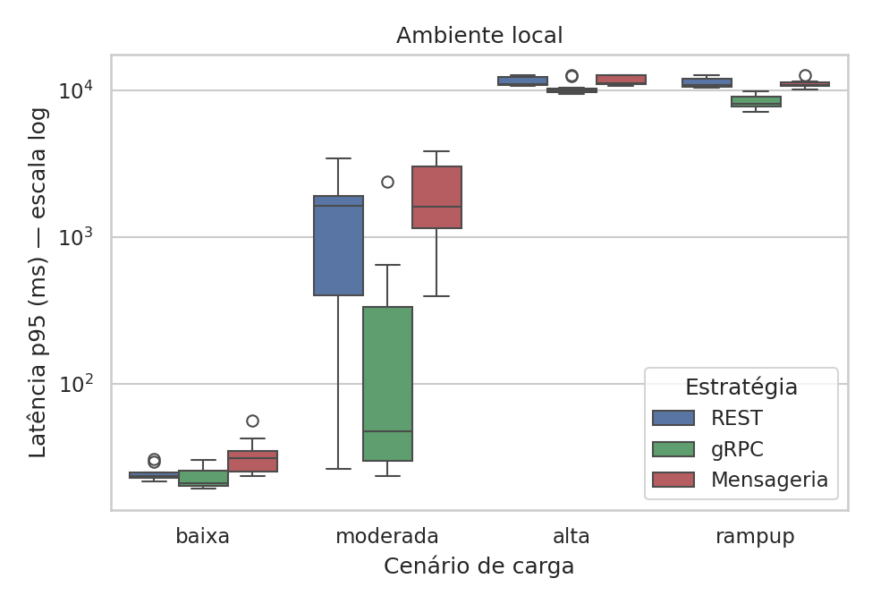

# Resultados dos experimentos

Gerado por `analysis/estatistica.py` a partir de 120 execuções. Amostras suspeitas excluídas (saltos de relógio): 2612.

## Métodos

- **Unidade de análise:** cada execução (repetição) de 60 s de medição, após 30 s de aquecimento,
  com ambiente recriado do zero. As métricas de cada execução vêm do k6 (lado do cliente);
  CPU e memória somam os contêineres da aplicação (serviços, bancos e broker) via `docker stats`.
- **Descritiva:** média, desvio padrão, mediana, coeficiente de variação (CV) e intervalo de
  confiança de 95% da média (t de Student).
- **Entre estratégias:** Kruskal-Wallis (3 grupos) seguido de Mann-Whitney bilateral par a par,
  com correção de Holm para comparações múltiplas. Testes não paramétricos porque, com ~10
  repetições por grupo, não se pode assumir normalidade, e métricas de latência costumam ser
  assimétricas.
- **Tamanho de efeito:** delta de Cliff (−1 a 1), com os limiares de Romano et al. (2006):
  < 0,147 desprezível, < 0,33 pequeno, < 0,474 médio, ≥ 0,474 grande. Complementa o p-valor,
  que sozinho não diz se a diferença é relevante.
- **Local × nuvem:** Mann-Whitney (diferença de posição) e Brown-Forsythe (diferença de
  variabilidade), além da comparação dos CVs.
- **Nível de significância:** α = 0,05.
- **Amostras suspeitas:** requisições com duração acima de 2× o timeout (impossíveis na prática,
  causadas por saltos de relógio do host) são excluídas das estatísticas de latência pelo k6 e
  contadas em `amostras_suspeitas`.

## Estatística descritiva

### Ambiente local

| Cenário | Estratégia | n | Latência média (ms) | Latência mediana (ms) | Latência p95 (ms) | Throughput (req/s) | Erro técnico (%) | CPU total (% de 1 núcleo) | Memória total (MB) |
|---|---|---|---|---|---|---|---|---|---|
| baixa | REST | 10 | 20,02 ± 1,05 | 19,15 ± 0,63 | 24,87 ± 3,02 | 10,01 ± 0,01 | 0,00 ± 0,00 | 18,9 ± 0,7 | 385,3 ± 2,1 |
| baixa | gRPC | 10 | 17,56 ± 1,51 | 16,45 ± 0,44 | 22,74 ± 3,88 | 10,01 ± 0,01 | 0,00 ± 0,00 | 16,5 ± 0,9 | 406,4 ± 4,9 |
| baixa | Mensageria | 10 | 21,84 ± 3,61 | 19,52 ± 1,48 | 32,97 ± 10,10 | 10,01 ± 0,01 | 0,00 ± 0,00 | 34,1 ± 4,2 | 533,8 ± 7,9 |
| moderada | REST | 10 | 740,51 ± 581,62 | 632,97 ± 544,03 | 1.525,82 ± 1.226,66 | 97,99 ± 2,69 | 0,03 ± 0,09 | 292,7 ± 95,1 | 466,2 ± 21,0 |
| moderada | gRPC | 10 | 157,11 ± 362,30 | 127,82 ± 346,77 | 390,30 ± 731,64 | 99,60 ± 1,32 | 0,00 ± 0,00 | 165,6 ± 53,9 | 448,7 ± 14,5 |
| moderada | Mensageria | 10 | 978,31 ± 811,30 | 868,04 ± 857,28 | 1.980,79 ± 1.157,35 | 94,73 ± 6,26 | 0,00 ± 0,00 | 289,0 ± 45,4 | 592,1 ± 13,1 |
| alta | REST | 10 | 10.342,27 ± 145,74 | 10.000,57 ± 0,02 | 11.444,21 ± 894,04 | 100,44 ± 0,91 | 98,61 ± 2,86 | 465,9 ± 9,1 | 545,3 ± 7,7 |
| alta | gRPC | 10 | 7.538,83 ± 1.212,09 | 7.231,19 ± 1.035,64 | 10.421,62 ± 1.202,14 | 142,22 ± 15,49 | 12,94 ± 30,73 | 286,0 ± 23,8 | 617,7 ± 11,6 |
| alta | Mensageria | 10 | 9.812,80 ± 662,95 | 9.976,78 ± 74,34 | 11.663,75 ± 923,93 | 107,27 ± 4,12 | 67,30 ± 19,91 | 327,3 ± 16,5 | 701,9 ± 16,0 |
| rampup | REST | 10 | 6.382,02 ± 172,21 | 8.714,41 ± 610,78 | 11.286,14 ± 908,08 | 104,95 ± 1,55 | 25,52 ± 14,05 | 360,1 ± 7,0 | 491,0 ± 11,9 |
| rampup | gRPC | 10 | 4.491,56 ± 297,51 | 5.688,67 ± 485,16 | 8.384,22 ± 918,62 | 132,05 ± 5,02 | 0,18 ± 0,21 | 231,1 ± 10,1 | 517,2 ± 9,1 |
| rampup | Mensageria | 10 | 6.473,58 ± 501,59 | 8.047,39 ± 759,34 | 11.069,95 ± 723,04 | 106,50 ± 4,88 | 13,33 ± 12,47 | 287,6 ± 8,7 | 642,3 ± 10,7 |

Valores: média ± desvio padrão entre as repetições (cada repetição = uma execução de 60 s). Intervalos de confiança de 95% e coeficientes de variação estão em descritiva.csv.

## Comparação entre estratégias

### Ambiente local

| Cenário | Métrica | Kruskal-Wallis p | Par | Medianas | p (Holm) | δ de Cliff | Sig. |
|---|---|---|---|---|---|---|---|
| baixa | Latência média (ms) | < 0,001 | REST × gRPC | 19,90 × 16,77 | 0,012 | 0,74 (grande) | sim |
| baixa | Latência média (ms) | < 0,001 | REST × Mensageria | 19,90 × 20,71 | 0,241 | -0,32 (pequeno) | não |
| baixa | Latência média (ms) | < 0,001 | gRPC × Mensageria | 16,77 × 20,71 | 0,002 | -0,90 (grande) | sim |
| baixa | Latência mediana (ms) | < 0,001 | REST × gRPC | 19,38 × 16,34 | < 0,001 | 1,00 (grande) | sim |
| baixa | Latência mediana (ms) | < 0,001 | REST × Mensageria | 19,38 × 19,22 | 0,850 | -0,06 (desprezível) | não |
| baixa | Latência mediana (ms) | < 0,001 | gRPC × Mensageria | 16,34 × 19,22 | < 0,001 | -1,00 (grande) | sim |
| baixa | Latência p95 (ms) | 0,002 | REST × gRPC | 23,75 × 20,99 | 0,064 | 0,50 (grande) | não |
| baixa | Latência p95 (ms) | 0,002 | REST × Mensageria | 23,75 × 31,46 | 0,018 | -0,70 (grande) | sim |
| baixa | Latência p95 (ms) | 0,002 | gRPC × Mensageria | 20,99 × 31,46 | 0,008 | -0,80 (grande) | sim |
| baixa | Throughput (req/s) | 0,379 | REST × gRPC | 10,01 × 10,02 | 0,732 | -0,10 (desprezível) | não |
| baixa | Throughput (req/s) | 0,379 | REST × Mensageria | 10,01 × 10,02 | 0,555 | -0,30 (pequeno) | não |
| baixa | Throughput (req/s) | 0,379 | gRPC × Mensageria | 10,02 × 10,02 | 0,732 | -0,20 (pequeno) | não |
| baixa | Erro técnico (%) | — | REST × gRPC | 0,00 × 0,00 | 1,000 | 0,00 (desprezível) | não |
| baixa | Erro técnico (%) | — | REST × Mensageria | 0,00 × 0,00 | 1,000 | 0,00 (desprezível) | não |
| baixa | Erro técnico (%) | — | gRPC × Mensageria | 0,00 × 0,00 | 1,000 | 0,00 (desprezível) | não |
| baixa | CPU total (% de 1 núcleo) | < 0,001 | REST × gRPC | 19,2 × 16,1 | < 0,001 | 0,96 (grande) | sim |
| baixa | CPU total (% de 1 núcleo) | < 0,001 | REST × Mensageria | 19,2 × 34,1 | < 0,001 | -1,00 (grande) | sim |
| baixa | CPU total (% de 1 núcleo) | < 0,001 | gRPC × Mensageria | 16,1 × 34,1 | < 0,001 | -1,00 (grande) | sim |
| baixa | Memória total (MB) | < 0,001 | REST × gRPC | 385,0 × 405,1 | < 0,001 | -1,00 (grande) | sim |
| baixa | Memória total (MB) | < 0,001 | REST × Mensageria | 385,0 × 531,6 | < 0,001 | -1,00 (grande) | sim |
| baixa | Memória total (MB) | < 0,001 | gRPC × Mensageria | 405,1 × 531,6 | < 0,001 | -1,00 (grande) | sim |
| moderada | Latência média (ms) | 0,009 | REST × gRPC | 879,81 × 30,98 | 0,178 | 0,46 (médio) | não |
| moderada | Latência média (ms) | 0,009 | REST × Mensageria | 879,81 × 521,86 | 0,473 | -0,20 (pequeno) | não |
| moderada | Latência média (ms) | 0,009 | gRPC × Mensageria | 30,98 × 521,86 | 0,004 | -0,86 (grande) | sim |
| moderada | Latência mediana (ms) | 0,004 | REST × gRPC | 854,41 × 17,42 | 0,051 | 0,60 (grande) | não |
| moderada | Latência mediana (ms) | 0,004 | REST × Mensageria | 854,41 × 316,88 | 0,385 | -0,24 (pequeno) | não |
| moderada | Latência mediana (ms) | 0,004 | gRPC × Mensageria | 17,42 × 316,88 | 0,004 | -0,86 (grande) | sim |
| moderada | Latência p95 (ms) | 0,011 | REST × gRPC | 1.630,96 × 47,34 | 0,178 | 0,46 (médio) | não |
| moderada | Latência p95 (ms) | 0,011 | REST × Mensageria | 1.630,96 × 1.608,40 | 0,734 | -0,10 (desprezível) | não |
| moderada | Latência p95 (ms) | 0,011 | gRPC × Mensageria | 47,34 × 1.608,40 | 0,004 | -0,86 (grande) | sim |
| moderada | Throughput (req/s) | 0,003 | REST × gRPC | 98,82 × 100,02 | 0,038 | -0,60 (grande) | sim |
| moderada | Throughput (req/s) | 0,003 | REST × Mensageria | 98,82 × 98,74 | 0,405 | 0,23 (pequeno) | não |
| moderada | Throughput (req/s) | 0,003 | gRPC × Mensageria | 100,02 × 98,74 | 0,003 | 0,86 (grande) | sim |
| moderada | Erro técnico (%) | 0,040 | REST × gRPC | 0,00 × 0,00 | 0,234 | 0,30 (pequeno) | não |
| moderada | Erro técnico (%) | 0,040 | REST × Mensageria | 0,00 × 0,00 | 0,234 | 0,30 (pequeno) | não |
| moderada | Erro técnico (%) | 0,040 | gRPC × Mensageria | 0,00 × 0,00 | 1,000 | 0,00 (desprezível) | não |
| moderada | CPU total (% de 1 núcleo) | < 0,001 | REST × gRPC | 339,0 × 146,2 | 0,003 | 0,86 (grande) | sim |
| moderada | CPU total (% de 1 núcleo) | < 0,001 | REST × Mensageria | 339,0 × 275,9 | 0,571 | 0,16 (pequeno) | não |
| moderada | CPU total (% de 1 núcleo) | < 0,001 | gRPC × Mensageria | 146,2 × 275,9 | 0,003 | -0,88 (grande) | sim |
| moderada | Memória total (MB) | < 0,001 | REST × gRPC | 476,6 × 444,0 | 0,307 | 0,28 (pequeno) | não |
| moderada | Memória total (MB) | < 0,001 | REST × Mensageria | 476,6 × 584,4 | < 0,001 | -1,00 (grande) | sim |
| moderada | Memória total (MB) | < 0,001 | gRPC × Mensageria | 444,0 × 584,4 | < 0,001 | -1,00 (grande) | sim |
| alta | Latência média (ms) | < 0,001 | REST × gRPC | 10.287,91 × 7.236,83 | 0,008 | 0,80 (grande) | sim |
| alta | Latência média (ms) | < 0,001 | REST × Mensageria | 10.287,91 × 9.917,22 | 0,021 | 0,62 (grande) | sim |
| alta | Latência média (ms) | < 0,001 | gRPC × Mensageria | 7.236,83 × 9.917,22 | 0,008 | -0,80 (grande) | sim |
| alta | Latência mediana (ms) | < 0,001 | REST × gRPC | 10.000,57 × 6.819,45 | < 0,001 | 0,96 (grande) | sim |
| alta | Latência mediana (ms) | < 0,001 | REST × Mensageria | 10.000,57 × 10.000,24 | 0,003 | 0,84 (grande) | sim |
| alta | Latência mediana (ms) | < 0,001 | gRPC × Mensageria | 6.819,45 × 10.000,24 | 0,003 | -0,83 (grande) | sim |
| alta | Latência p95 (ms) | 0,005 | REST × gRPC | 11.016,00 × 10.001,01 | 0,028 | 0,66 (grande) | sim |
| alta | Latência p95 (ms) | 0,005 | REST × Mensageria | 11.016,00 × 11.117,16 | 0,273 | -0,30 (pequeno) | não |
| alta | Latência p95 (ms) | 0,005 | gRPC × Mensageria | 10.001,01 × 11.117,16 | 0,014 | -0,76 (grande) | sim |
| alta | Throughput (req/s) | < 0,001 | REST × gRPC | 100,02 × 147,72 | 0,002 | -0,90 (grande) | sim |
| alta | Throughput (req/s) | < 0,001 | REST × Mensageria | 100,02 × 108,68 | 0,010 | -0,68 (grande) | sim |
| alta | Throughput (req/s) | < 0,001 | gRPC × Mensageria | 147,72 × 108,68 | 0,003 | 0,84 (grande) | sim |
| alta | Erro técnico (%) | < 0,001 | REST × gRPC | 99,96 × 3,02 | 0,003 | 0,89 (grande) | sim |
| alta | Erro técnico (%) | < 0,001 | REST × Mensageria | 99,96 × 64,97 | 0,010 | 0,68 (grande) | sim |
| alta | Erro técnico (%) | < 0,001 | gRPC × Mensageria | 3,02 × 64,97 | 0,003 | -0,84 (grande) | sim |
| alta | CPU total (% de 1 núcleo) | < 0,001 | REST × gRPC | 462,8 × 278,0 | < 0,001 | 1,00 (grande) | sim |
| alta | CPU total (% de 1 núcleo) | < 0,001 | REST × Mensageria | 462,8 × 327,7 | < 0,001 | 1,00 (grande) | sim |
| alta | CPU total (% de 1 núcleo) | < 0,001 | gRPC × Mensageria | 278,0 × 327,7 | 0,002 | -0,82 (grande) | sim |
| alta | Memória total (MB) | < 0,001 | REST × gRPC | 543,8 × 616,6 | < 0,001 | -1,00 (grande) | sim |
| alta | Memória total (MB) | < 0,001 | REST × Mensageria | 543,8 × 697,9 | < 0,001 | -1,00 (grande) | sim |
| alta | Memória total (MB) | < 0,001 | gRPC × Mensageria | 616,6 × 697,9 | < 0,001 | -1,00 (grande) | sim |
| rampup | Latência média (ms) | < 0,001 | REST × gRPC | 6.385,53 × 4.461,01 | < 0,001 | 1,00 (grande) | sim |
| rampup | Latência média (ms) | < 0,001 | REST × Mensageria | 6.385,53 × 6.273,37 | 0,791 | 0,08 (desprezível) | não |
| rampup | Latência média (ms) | < 0,001 | gRPC × Mensageria | 4.461,01 × 6.273,37 | < 0,001 | -1,00 (grande) | sim |
| rampup | Latência mediana (ms) | < 0,001 | REST × gRPC | 8.595,60 × 5.639,83 | < 0,001 | 1,00 (grande) | sim |
| rampup | Latência mediana (ms) | < 0,001 | REST × Mensageria | 8.595,60 × 7.769,13 | 0,064 | 0,50 (grande) | não |
| rampup | Latência mediana (ms) | < 0,001 | gRPC × Mensageria | 5.639,83 × 7.769,13 | < 0,001 | -1,00 (grande) | sim |
| rampup | Latência p95 (ms) | < 0,001 | REST × gRPC | 10.902,80 × 8.095,49 | < 0,001 | 1,00 (grande) | sim |
| rampup | Latência p95 (ms) | < 0,001 | REST × Mensageria | 10.902,80 × 10.889,16 | 0,791 | 0,08 (desprezível) | não |
| rampup | Latência p95 (ms) | < 0,001 | gRPC × Mensageria | 8.095,49 × 10.889,16 | < 0,001 | -1,00 (grande) | sim |
| rampup | Throughput (req/s) | < 0,001 | REST × gRPC | 104,88 × 133,56 | < 0,001 | -1,00 (grande) | sim |
| rampup | Throughput (req/s) | < 0,001 | REST × Mensageria | 104,88 × 107,01 | 0,385 | -0,24 (pequeno) | não |
| rampup | Throughput (req/s) | < 0,001 | gRPC × Mensageria | 133,56 × 107,01 | < 0,001 | 1,00 (grande) | sim |
| rampup | Erro técnico (%) | < 0,001 | REST × gRPC | 20,64 × 0,08 | < 0,001 | 1,00 (grande) | sim |
| rampup | Erro técnico (%) | < 0,001 | REST × Mensageria | 20,64 × 8,43 | 0,038 | 0,56 (grande) | sim |
| rampup | Erro técnico (%) | < 0,001 | gRPC × Mensageria | 0,08 × 8,43 | < 0,001 | -1,00 (grande) | sim |
| rampup | CPU total (% de 1 núcleo) | < 0,001 | REST × gRPC | 359,8 × 226,7 | < 0,001 | 1,00 (grande) | sim |
| rampup | CPU total (% de 1 núcleo) | < 0,001 | REST × Mensageria | 359,8 × 286,2 | < 0,001 | 1,00 (grande) | sim |
| rampup | CPU total (% de 1 núcleo) | < 0,001 | gRPC × Mensageria | 226,7 × 286,2 | < 0,001 | -1,00 (grande) | sim |
| rampup | Memória total (MB) | < 0,001 | REST × gRPC | 489,2 × 513,4 | 0,002 | -0,84 (grande) | sim |
| rampup | Memória total (MB) | < 0,001 | REST × Mensageria | 489,2 × 642,7 | < 0,001 | -1,00 (grande) | sim |
| rampup | Memória total (MB) | < 0,001 | gRPC × Mensageria | 513,4 × 642,7 | < 0,001 | -1,00 (grande) | sim |

δ de Cliff > 0: a primeira estratégia do par tem valores maiores. Significativo: p ajustado por Holm < 0,05.

## Comparação entre ambientes (local × nuvem)

_Ainda não há execuções nos dois ambientes para comparar._

## CPU por contêiner

**local — baixa** (CPU média, % de 1 núcleo)

| Contêiner | REST | gRPC | Mensageria |
|---|---|---|---|
| db_estoque | 0,9 | 0,9 | 1,0 |
| db_pagamento | 0,8 | 0,7 | 0,8 |
| db_pedidos | 0,9 | 0,9 | 0,9 |
| db_usuario | 0,7 | 0,7 | 0,7 |
| estoque | 4,2 | 3,3 | 3,4 |
| pagamento | 3,2 | 2,3 | 2,4 |
| pedidos | 5,6 | 5,6 | 6,3 |
| rabbitmq | — | — | 16,1 |
| usuario | 2,8 | 2,2 | 2,3 |

**local — moderada** (CPU média, % de 1 núcleo)

| Contêiner | REST | gRPC | Mensageria |
|---|---|---|---|
| db_estoque | 19,1 | 9,2 | 20,3 |
| db_pagamento | 13,5 | 6,0 | 11,8 |
| db_pedidos | 16,9 | 8,3 | 13,9 |
| db_usuario | 14,4 | 3,5 | 11,7 |
| estoque | 59,8 | 37,2 | 50,6 |
| pagamento | 50,3 | 24,5 | 36,0 |
| pedidos | 71,5 | 56,1 | 72,9 |
| rabbitmq | — | — | 37,4 |
| usuario | 47,3 | 20,7 | 34,2 |

**local — alta** (CPU média, % de 1 núcleo)

| Contêiner | REST | gRPC | Mensageria |
|---|---|---|---|
| db_estoque | 32,6 | 26,6 | 19,4 |
| db_pagamento | 30,6 | 14,3 | 14,0 |
| db_pedidos | 23,3 | 19,5 | 20,9 |
| db_usuario | 32,6 | 5,0 | 14,0 |
| estoque | 81,7 | 53,7 | 44,0 |
| pagamento | 85,1 | 41,5 | 40,7 |
| pedidos | 99,1 | 97,9 | 96,7 |
| rabbitmq | — | — | 38,3 |
| usuario | 80,9 | 27,6 | 39,4 |

**local — rampup** (CPU média, % de 1 núcleo)

| Contêiner | REST | gRPC | Mensageria |
|---|---|---|---|
| db_estoque | 24,0 | 19,0 | 16,5 |
| db_pagamento | 21,0 | 10,1 | 11,6 |
| db_pedidos | 16,9 | 14,6 | 14,7 |
| db_usuario | 23,6 | 4,6 | 12,5 |
| estoque | 66,6 | 47,8 | 42,7 |
| pagamento | 65,4 | 33,5 | 35,4 |
| pedidos | 78,6 | 77,1 | 79,0 |
| rabbitmq | — | — | 37,9 |
| usuario | 63,9 | 24,5 | 37,2 |

## Figuras

